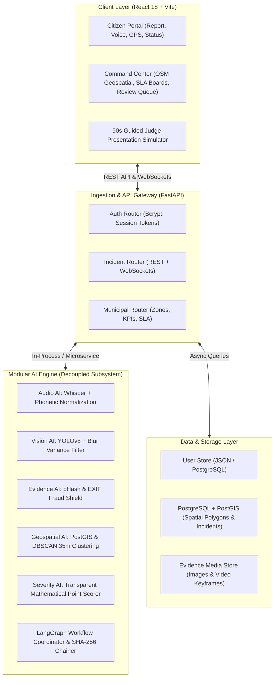
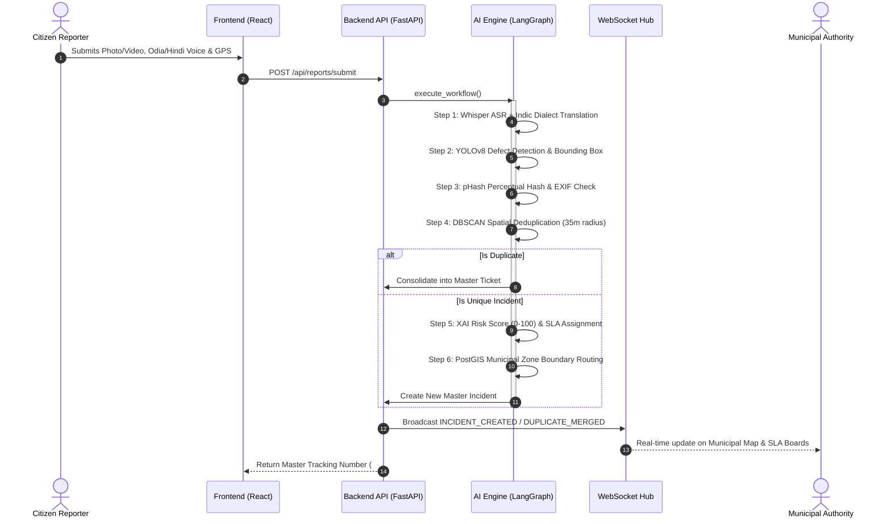

# CivicPulse System Architecture & Technical Specification

> **From Citizen Complaints to Verified Civic Action — An Autonomous Municipal Intelligence Platform.**

---

## 1. High-Level Architecture Diagram

---

## 2. Multi-Step AI Verification Pipeline

---

## 3. Core Technical Modules

### Module 1: Multimodal Ingestion & Multilingual Voice (Whisper AI)
- Transcribes voice complaints in **English, Hindi, Odia, Bengali, and Telugu**.
- Employs phonetic dictionary normalization to ensure Indic dialect variants (e.g., Odia `"ଗତ"` $\rightarrow$ `"ଗାତ"`, Bengali `"গত"` $\rightarrow$ `"গর্ত"`) translate into standardized English defect summaries without Indic leakage.

### Module 2: Vision Inspector & Defect Extraction (OpenCV + YOLOv8)
- Samples 4 keyframes from citizen uploads and evaluates Laplacian blur variance ($> 40$ sharpness threshold).
- Predicts bounding boxes, defect volume percentage, and collapse severity across 8 civic problem categories.

### Module 3: Evidence Authenticity & Anti-Fraud (pHash + EXIF)
- Computes 64-bit perceptual image hashes to prevent recycled photos or duplicate fraud.
- Guardrail: Low-confidence items ($< 70\%$) are safely held in the Human Review Queue instead of auto-rejection.

### Module 4: Spatial Deduplication Intelligence (DBSCAN + Category)
- Groups incoming reports within a **35-meter radius** sharing identical defect categories.
- Consolidates redundant citizen reports into a canonical master ticket with match confidence scores.

### Module 5: Autonomous Jurisdiction Routing & SLA Allocation
- Evaluates coordinates against deterministic PostGIS municipal polygon boundaries across **Zones 1–5**.
- Enforces strict SLA countdowns:
  - **P1 Critical**: 4 hours
  - **P2 High**: 12 hours
  - **P3 Medium**: 24 hours
  - **P4 Low**: 72 hours

### Module 6: Closed-Loop Before/After Repair Verification
- Municipal officers upload after-repair photos on-site.
- Validates GPS delta ($< 30$ meters) and computes Structural Similarity Index (SSIM) score (e.g. 91.4%).
- Requires citizen inspection before official ticket closure.

### Module 7: Explainable AI (XAI) & Cryptographic Audit Trails
- Transparent mathematical scoring: `Base Severity + Proximity Penalty + Traffic Level + Worsening Trend`.
- Every ticket transition appends a cryptographically chained SHA-256 audit entry.
